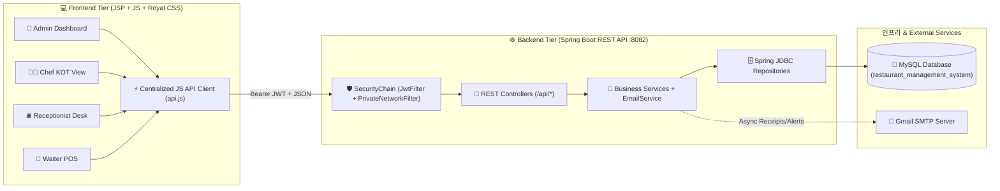

<div align="center">

# 🍽️ Royal Dine — Full-Stack Restaurant Management System

**An Enterprise-Grade, Role-Based Restaurant Operations & POS Platform built with Spring Boot, JWT Security, MySQL, and Jakarta EE (JSP)**

### 🚀 **[🌐 View Live Application (foodhubserver.co.in)](https://foodhubserver.co.in)** &nbsp;|&nbsp; 👩‍💻 **[Developer Portfolio](https://siddhiarote0420.github.io/Portfolio/)**

[](https://foodhubserver.co.in)
[](https://openjdk.org/projects/jdk/17/)
[](https://spring.io/projects/spring-boot)
[](https://spring.io/projects/spring-security)
[](https://www.mysql.com/)
[](https://swagger.io/)
[](https://jakarta.ee/)

</div>

---

## 📌 Project Overview

**Restaurant Management System** is a full-stack web application engineered to streamline end-to-end restaurant operations—from table reservations and live kitchen order queues (KOT) to staff administration, menu curation, billing, and real-time revenue analytics.

The repository follows a clean **Monorepo Architecture** separating the stateless **Spring Boot REST Backend** ([`backend/`](./backend)) and the **Responsive Role-Based Web Frontend** ([`frontend/`](./frontend)).

---

## ✨ Key Engineering Highlights (What Makes This Project Unique)

- 🔐 **Stateless JWT Authentication & RBAC:** Custom `JwtFilter` and `JwtUtil` securing REST endpoints with role-specific access control across **Admin**, **Chef**, **Receptionist**, and **Waiter** workflows.
- 🛡️ **Jasypt Configuration Encryption:** Sensitive database credentials in `application.yml` are encrypted at rest using **Jasypt (`PBEWithMD5AndDES`)** via `JasyptConfig`, preventing plaintext credential exposure.
- 🌐 **CORS & Private Network Access (PNA) Compliance:** Custom `PrivateNetworkFilter` and `WebConfig` handling modern browser preflight and private network security headers.
- 📦 **Standardized API Envelopes & Global Exception Handling:** Uniform JSON responses via generic `ApiResponse<T>` and `PaginatedResponse<T>` DTOs, backed by `@RestControllerAdvice` (`GlobalExceptionHandler`) for clean HTTP status reporting.
- 📧 **Automated Email Notifications:** Integrated `Spring Mail (JavaMailSender)` via `EmailService` for automated order and billing notifications.
- 🎨 **Dual-Theme Responsive UI (Royal Dark & Light Mode):** Custom-crafted CSS design system (`royal_dashboard.css`, `light_theme.css`, `responsive.css`) with instant theme toggling (`theme.js`) and centralized API client (`api.js`).

---

## 🏗️ System Architecture



---

## 👥 Role-Based Dashboards & Modules

| Role | Dedicated Dashboard | Core Capabilities |
| :--- | :--- | :--- |
| **👑 Admin** | `AdminDashboard.jsp` | Real-time KPI cards, revenue analytics (`SalesManagement.jsp`), full CRUD over Menu (`MenuManagement.jsp`), Staff (`StaffManagement.jsp`), Tables (`TablesManagement.jsp`), and Orders (`OrdersManagement.jsp`). |
| **👨‍🍳 Chef** | `ChefDashboard.jsp` | Live Kitchen Order Ticket (KOT) queue, item-level preparation tracking, and instant order status transitions (`PENDING` $\rightarrow$ `PREPARING` $\rightarrow$ `READY`). |
| **🧾 Waiter** | `WaiterDashboard.jsp` | Interactive table selection, digital menu ordering, cart management, live order placement, and serving status updates (`SERVED`). |
| **🛎️ Receptionist** | `ReceptionistDashboard.jsp` | Table occupancy monitoring (`AVAILABLE` / `OCCUPIED` / `RESERVED`), guest allocation, invoice generation, and multi-mode payment settlement (`CASH`, `CARD`, `UPI`). |

---

## 📂 Repository Structure

```text
RestaurantManagementSystem/
├── backend/                                  # Spring Boot 3 REST API Server (Port 8082)
│   ├── src/main/java/com/example/demo/
│   │   ├── config/                           # JasyptConfig & CORS WebConfig
│   │   ├── constant/                         # Centralized SQL Queries (SqlQueries.java)
│   │   ├── controller/                       # REST Controllers (Login, Dashboard, Menu, Order, Payment, Staff, Table)
│   │   ├── dto/                              # ApiResponse, PaginatedResponse, Order/Menu/Staff DTOs
│   │   ├── entity/                           # Domain Entities (Menu, Category, Order, OrderDetail, Payment, Staff, Table)
│   │   ├── exception/                        # GlobalExceptionHandler, ResourceNotFoundException, InvalidInputException
│   │   ├── repository/                       # Spring JDBC Repositories
│   │   ├── security/                         # SecurityConfig, JwtFilter, JwtUtil, PrivateNetworkFilter
│   │   ├── service/                          # Transactional Business Logic & EmailService
│   │   └── util/                             # JasyptEncryptorMain Utility
│   ├── src/main/resources/application.yml    # Encrypted App & DB Configuration
│   ├── src/test/java/com/example/demo/       # JUnit 5 Tests (JwtSecurityTest, JasyptEncryptorTest)
│   └── pom.xml                               # Backend Maven Dependencies
│
├── frontend/                                 # Jakarta EE (JSP/Servlet) Web Application (Port 8080)
│   ├── src/main/webapp/
│   │   ├── CSS/                              # Royal Dark & Light Themes + Responsive Stylesheets
│   │   ├── JS/                               # api.js (JWT Fetch Wrapper), dashboard.js, theme.js
│   │   ├── Images/                           # Brand Assets & Dish Photography
│   │   ├── HomePage.jsp                      # Landing & Role Authentication Portal
│   │   ├── AdminDashboard.jsp                # Executive Overview & Analytics
│   │   ├── ChefDashboard.jsp                 # Kitchen Display System (KDS)
│   │   ├── WaiterDashboard.jsp               # Waiter POS & Order Entry
│   │   ├── ReceptionistDashboard.jsp         # Front-Desk Table & Billing Console
│   │   ├── MenuManagement.jsp                # Dish & Category Administration
│   │   ├── OrdersManagement.jsp              # Order Lifecycle Tracking
│   │   ├── SalesManagement.jsp               # Financial Reports & Revenue Charts
│   │   ├── StaffManagement.jsp               # Employee Onboarding & Role Management
│   │   └── TablesManagement.jsp              # Floor Plan & Capacity Configuration
│   └── pom.xml                               # Frontend WAR Maven Configuration
│
└── README.md                                 # Project Documentation
```

---

## 🔌 REST API Overview

Once the backend is running, interactive **Swagger UI** documentation is available at:
👉 `http://localhost:8082/swagger-ui/index.html`

| Module | Base Endpoint | Key Operations |
| :--- | :--- | :--- |
| **Authentication** | `/api/login` | `POST` Authenticate staff credentials & issue signed JWT token |
| **Dashboard KPIs** | `/api/dashboard` | `GET` Aggregated revenue, order counts, active tables, and top-selling items |
| **Menu & Categories** | `/api/menu` | `GET` (paginated), `POST`, `PUT`, `DELETE` menu items & category filters |
| **Orders (KOT)** | `/api/orders` | `POST` create multi-item order, `GET` active/completed orders, `PUT` status updates |
| **Tables** | `/api/tables` | `GET` floor status, `POST` add table, `PUT` update occupancy/capacity, `DELETE` |
| **Staff** | `/api/staff` | `GET` staff directory, `POST` onboard staff, `PUT` update role/salary, `DELETE` |
| **Payments & Billing**| `/api/payments` | `POST` process bill settlement & trigger email receipt, `GET` transaction history |

---

## 🚀 Getting Started (Local Setup)

### Prerequisites
- **Java Development Kit (JDK):** Version 17 or higher
- **Maven:** 3.8+ (or use the included `mvnw` wrapper)
- **Database:** MySQL Server 8.0+
- **Servlet Container (for Frontend):** Apache Tomcat 10.1+

### 1️⃣ Clone the Repository
```bash
git clone https://github.com/SiddhiArote0420/RestaurantManagementSystem.git
cd RestaurantManagementSystem
```

### 2️⃣ Database Setup
1. Create a MySQL database named `restaurant_management_system`:
   ```sql
   CREATE DATABASE restaurant_management_system;
   ```
2. Update your MySQL username/password in `backend/src/main/resources/application.yml` (or encrypt your password using `JasyptEncryptorMain`).

### 3️⃣ Run the Spring Boot Backend (`:8082`)
```bash
cd backend
./mvnw spring-boot:run
```
> The backend REST API will start at `http://localhost:8082`.

### 4️⃣ Deploy the Web Frontend (`:8080`)
1. Import the `frontend/` directory as a **Maven Web Project** in Eclipse / STS / IntelliJ IDEA, or build the WAR file:
   ```bash
   cd ../frontend
   mvn clean package
   ```
2. Deploy the generated `RestaurantFrontend.war` on **Apache Tomcat 10.1+** running on port `8080`.
3. Open your browser and navigate to:
   👉 `http://localhost:8080/RestaurantFrontend/HomePage.jsp`

---

## 🧪 Running Unit Tests
The backend includes unit tests verifying **JWT Token Generation/Validation** and **Jasypt Property Encryption**:
```bash
cd backend
./mvnw test
```

---

## 👩‍💻 Author

**Siddhi Arote**
- 🐙 GitHub: [@SiddhiArote0420](https://github.com/SiddhiArote0420)
- 📧 Email: siddhiarote5@gmail.com
